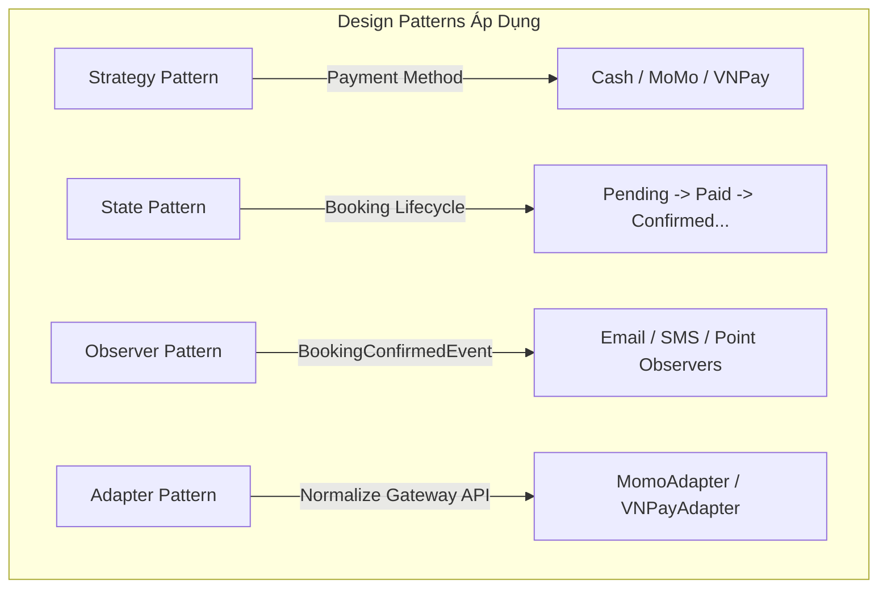

# 🎬 Hệ Thống Quản Lý Rạp Chiếu Phim - Design Patterns Demo

> **Đề tài Chuyên đề Kỹ thuật Phần mềm:**  
> *“Nghiên cứu, ứng dụng và đánh giá Design Patterns trong hệ thống quản lý rạp chiếu phim”*

---

## 📌 1. Giới thiệu Đề tài & Mục tiêu

Dự án được xây dựng với mục tiêu **nghiên cứu, thực nghiệm và đánh giá thực tế** việc áp dụng các Mẫu thiết kế phần mềm (Design Patterns) vào một bài toán nghiệp vụ kinh điển: **Hệ thống Quản lý và Đặt vé Rạp chiếu phim**.

### Mục tiêu học thuật:
- **Chứng minh lý do áp dụng pattern:** Không ép pattern vào hệ thống khi chưa có vấn đề thiết kế cụ thể.
- **So sánh trực quan Trước & Sau khi áp dụng:**
  - *Vấn đề thiết kế (Code mùi, vi phạm SOLID, vi phạm OCP/SRP, chuỗi `if-else` phức tạp)*
  - *Lựa chọn Pattern phù hợp*
  - *Refactoring & Đánh giá kết quả đạt được (dễ mở rộng, dễ bảo trì, dễ viết unit test độc lập)*.
- **Mã nguồn đơn giản, rõ ràng:** Giữ kiến trúc mạch lạc, dễ đọc, dễ giải thích trong buổi báo cáo/thuyết trình chuyên đề.

---

## 🛠 2. Công nghệ Sử dụng (Tech Stack)

| Thành phần | Công nghệ / Thư viện | Ghi chú |
| :--- | :--- | :--- |
| **Ngôn ngữ** | Java 17 / Java 21 | Phiên bản LTS tiêu chuẩn |
| **Framework** | Spring Boot 3.3.5 | Spring Web, Spring Data JPA, Validation |
| **Giao diện (Frontend)** | Thymeleaf + Bootstrap 5 | Bootstrap Icons, CSS tùy biến giao diện rạp phim |
| **Cơ sở dữ liệu** | H2 Database (In-Memory) | Xem trực quan qua `/h2-console` |
| **Build Tool** | Apache Maven (Maven Wrapper) | Chạy ngay không cần cài sẵn Maven toàn cục |
| **Kiểm thử** | JUnit 5 + Spring Boot Test | Đánh giá độ tin cậy và kiểm thử các Pattern |

> *Lưu ý kiến trúc:* Không sử dụng Microservices, Kafka, Redis hay Authentication phức tạp ở giai đoạn này để tập trung 100% vào việc minh họa Design Patterns.

---

## 🏛 3. Cấu trúc Thư mục & Kiến trúc Project

Dự án tuân thủ mô hình kiến trúc phân lớp chuẩn (Layered Architecture):

```
DEMO_DesignPattern_CinemaManagement/
├── .mvn/wrapper/               # Maven wrapper binaries & config
├── src/
│   ├── main/
│   │   ├── java/com/cinema/cinemamanagement/
│   │   │   ├── config/         # Cấu hình Spring & Seed dữ liệu mẫu (DataInitializer)
│   │   │   ├── controller/     # Web MVC Controllers (Dashboard, Movie, Showtime,...)
│   │   │   ├── dto/            # Data Transfer Objects & Bean Validation
│   │   │   ├── entity/         # JPA Entities (Movie, Showtime, Seat, Booking)
│   │   │   ├── repository/     # Spring Data JPA Repositories
│   │   │   ├── service/        # Interface & Implementation của các nghiệp vụ
│   │   │   │   └── impl/
│   │   │   ├── pattern/        # [Phase 2] Thư mục chứa các Design Patterns
│   │   │   │   ├── strategy/   # Strategy Pattern cho Payment
│   │   │   │   ├── state/      # State Pattern cho Booking
│   │   │   │   ├── observer/   # Observer Pattern cho Booking Events
│   │   │   │   └── adapter/    # Adapter Pattern cho Momo / VNPay Gateway
│   │   │   └── CinemaManagementApplication.java
│   │   └── resources/
│   │       ├── static/css/     # Custom styling (styles.css)
│   │       ├── templates/      # Giao diện Thymeleaf
│   │       │   ├── layout/     # main.html (Navbar, alert, footer)
│   │       │   ├── movies/     # list.html, form.html, detail.html
│   │       │   ├── showtimes/  # list.html, form.html, seats.html
│   │       │   ├── dashboard.html
│   │       │   └── placeholder.html
│   │       └── application.properties
│   └── test/java/com/cinema/cinemamanagement/
│       ├── CinemaManagementApplicationTests.java
│       └── Phase1ServicesTest.java   # Unit tests kiểm thử Movie CRUD & sinh ghế
├── mvnw / mvnw.cmd             # Maven Wrapper scripts
├── pom.xml
└── README.md
```

---

## 🎯 4. Các Design Patterns Bắt buộc trong Đề tài



### 1. Strategy Pattern – Thanh toán (Payment)
- **Vấn đề thiết kế:** `PaymentService` thường chứa chuỗi `if (type == CASH) ... else if (type == MOMO) ... else if (type == VNPAY) ...` gây phình to mã nguồn và vi phạm **Open/Closed Principle (OCP)** khi muốn bổ sung phương thức thanh toán mới.
- **Giải pháp:** Định nghĩa interface `PaymentStrategy` với các implementation:
  - `CashPaymentStrategy`
  - `MomoPaymentStrategy`
  - `VNPayPaymentStrategy`
- **Kết quả:** `PaymentService` chỉ phụ thuộc vào abstraction, dễ dàng bổ sung phương thức mới mà không sửa code cũ, dễ viết unit test độc lập.

### 2. State Pattern – Vòng đời Đặt vé (Booking)
- **Vấn đề thiết kế:** Quá trình đặt vé trải qua nhiều trạng thái (`PENDING`, `AWAITING_PAYMENT`, `PAID`, `CONFIRMED`, `CANCELLED`, `REFUNDED`, `EXPIRED`). Nếu xử lý bằng điều kiện lồng nhau, mã nguồn trở nên rối loạn, khó kiểm soát hành động nào hợp lệ tại trạng thái nào.
- **Giải pháp:** Định nghĩa interface `BookingState` với các implementation cụ thể:
  - `PendingState`, `AwaitingPaymentState`, `PaidState`, `ConfirmedState`, `CancelledState`, `RefundedState`, `ExpiredState`.
- **Hành vi quy định:**
  - `pay()`, `confirm()`, `cancel()`, `refund()`.
  - Từ chối và ném exception tường minh nếu hành động không hợp lệ (ví dụ: `Cancelled` không được phép thanh toán, `Confirmed` không thanh toán lại).

### 3. Observer Pattern – Sự kiện sau khi Đặt vé Thành công
- **Vấn đề thiết kế:** Khi vé được xác nhận (`CONFIRMED`), hệ thống cần gửi Email, SMS và tích điểm thành viên. Nếu gọi trực tiếp `emailService`, `smsService`, `memberService` trong `BookingService` sẽ gây ra **Tight Coupling** (liên kết chặt chẽ).
- **Giải pháp:** Sau khi xác nhận booking, hệ thống phát ra sự kiện `BookingConfirmedEvent`. Các observer lắng nghe độc lập:
  - `EmailNotificationObserver`
  - `SmsNotificationObserver`
  - `MemberPointObserver`
- **Kết quả:** `BookingService` không cần biết có bao nhiêu bên quan tâm đến sự kiện, giảm khớp nối và dễ dàng thêm thông báo mới (như Push Notification).

### 4. Adapter Pattern – Tích hợp Cổng thanh toán bên ngoài (Payment Gateway)
- **Vấn đề thiết kế:** Các nhà cung cấp ví/cổng thanh toán có interface gọi API hoàn toàn khác nhau:
  - MoMo: `MomoExternalApi.createPayment(...)`
  - VNPay: `VNPayExternalApi.createTransaction(...)`
- **Giải pháp:** Định nghĩa interface chuẩn trong hệ thống: `PaymentGateway` với phương thức `PaymentResult pay(...)`. Xây dựng các Adapter:
  - `MomoPaymentAdapter`
  - `VNPayPaymentAdapter`
- **Kết quả:** Chuẩn hóa giao diện bên thứ ba về giao diện chung của hệ thống, bảo vệ lõi nghiệp vụ không bị phụ thuộc vào API bên ngoài.

---

## 🚀 5. Hướng dẫn Khởi chạy Ứng dụng

### Yêu cầu môi trường
- Đã cài đặt **JDK 17** hoặc **JDK 21**.
- Kiểm tra bằng lệnh:
  ```powershell
  java -version
  ```

### Các bước khởi chạy

1. **Mở terminal** tại thư mục gốc của project:
   ```powershell
   cd c:\Users\ADMIN\Documents\CSE_TLU-outline\Subjects\CDKTPM\DEMO_DesignPattern_CinemaManagement
   ```

2. **Chạy ứng dụng bằng Maven Wrapper**:
   ```powershell
   .\mvnw.cmd spring-boot:run
   ```
   *(Trên Linux/macOS: `./mvnw spring-boot:run`)*

3. **Chạy bộ kiểm thử (Unit Tests)**:
   ```powershell
   .\mvnw.cmd test
   ```

---

## 🌐 6. Địa chỉ Truy cập & Kiểm tra (URLs)

Khi ứng dụng chạy thành công, truy cập các đường dẫn sau trên trình duyệt:

| Chức năng | URL | Mô tả |
| :--- | :--- | :--- |
| **Dashboard** | [http://localhost:8080/](http://localhost:8080/) | Thống kê số lượng phim, suất chiếu, lịch chiếu sắp tới |
| **Danh sách Phim** | [http://localhost:8080/movies](http://localhost:8080/movies) | Xem kho phim, tìm kiếm, sửa, xóa, xem chi tiết |
| **Thêm Phim Mới** | [http://localhost:8080/movies/new](http://localhost:8080/movies/new) | Form nhập phim mới có validation |
| **Quản lý Suất Chiếu** | [http://localhost:8080/showtimes](http://localhost:8080/showtimes) | Xem lịch chiếu, giá vé cơ bản |
| **Tạo Suất Chiếu** | [http://localhost:8080/showtimes/new](http://localhost:8080/showtimes/new) | Tạo suất và tự động sinh 30 ghế ngồi A1–C10 |
| **Sơ đồ Ghế Ngồi** | [http://localhost:8080/showtimes/1/seats](http://localhost:8080/showtimes/1/seats) | Trực quan hóa ma trận ghế (AVAILABLE, HELD, BOOKED) |
| **H2 Console** | [http://localhost:8080/h2-console](http://localhost:8080/h2-console) | Quản trị cơ sở dữ liệu in-memory |

### Thông số kết nối H2 Console:
- **JDBC URL:** `jdbc:h2:mem:cinemadb`
- **User Name:** `sa`
- **Password:** *(để trống)*

---

## 📊 7. Trạng thái Tiến độ Triển khai

- [x] **Phase 1: Khởi tạo Nền tảng & CRUD Cơ bản (ĐÃ HOÀN THÀNH)**
  - [x] Khởi tạo dự án Spring Boot 3 + Maven Wrapper + H2 in-memory DB.
  - [x] Tạo đầy đủ Entity & Repository: `Movie`, `Showtime`, `Seat`, `SeatStatus`, `Booking`, `BookingStatus`.
  - [x] Tự động nạp dữ liệu mẫu (`DataInitializer`): 3 phim nổi tiếng, 5 suất chiếu, 30 ghế A1-C10 cho mỗi suất chiếu.
  - [x] Hoàn thiện CRUD Phim & Suất chiếu với Bean Validation.
  - [x] Thiết kế giao diện Thymeleaf + Bootstrap 5 trực quan.
  - [x] Viết Unit Test cơ bản (`Phase1ServicesTest` đạt 100% Passed).
- [ ] **Phase 2: Triển khai 4 Design Patterns Bắt buộc (BƯỚC TIẾP THEO)**
  - [ ] Strategy Pattern: Xây dựng bộ thanh toán Cash, MoMo, VNPay.
  - [ ] State Pattern: Triển khai máy trạng thái vòng đời Booking.
  - [ ] Observer Pattern: Triển khai `BookingConfirmedEvent` và các Observer (Email, SMS, Member Point).
  - [ ] Adapter Pattern: Giả lập `MomoExternalApi` & `VNPayExternalApi` và tạo Adapter tương ứng.
  - [ ] Luồng tương tác đặt vé trên giao diện (chọn ghế -> giữ chỗ -> thanh toán -> xác nhận).
  - [ ] Viết bộ Unit Test riêng cho từng Design Pattern phục vụ báo cáo.

