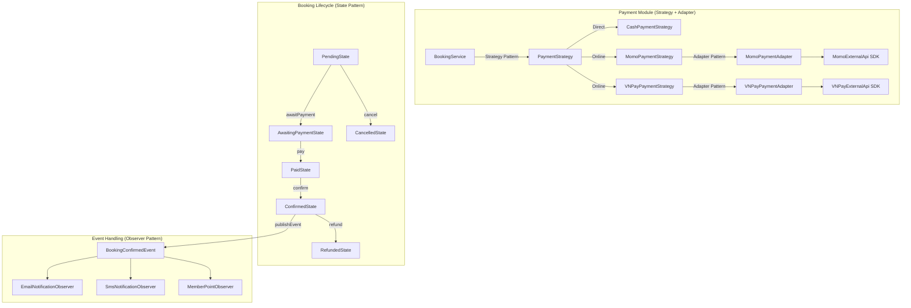

# 🎬 Hệ Thống Quản Lý Rạp Chiếu Phim - Design Patterns Demo

> **Đề tài Chuyên đề Kỹ thuật Phần mềm:**  
> *“Nghiên cứu, ứng dụng và đánh giá Design Patterns trong hệ thống quản lý rạp chiếu phim”*

---

## 📌 1. Giới thiệu Đề tài & Mục tiêu Nghiên Cứu

Dự án được xây dựng với mục tiêu **nghiên cứu, thực nghiệm và đánh giá thực tế** việc áp dụng các Mẫu thiết kế phần mềm (Design Patterns) vào một bài toán nghiệp vụ kinh điển: **Hệ thống Quản lý và Đặt vé Rạp chiếu phim**.

### Mục tiêu học thuật:
- **Chứng minh lý do áp dụng pattern:** Tuyệt đối không chọn pattern trước rồi ép vào chức năng; chỉ áp dụng khi có bài toán kiến trúc cụ thể (code smell, vi phạm SOLID, coupling cao, khó mở rộng).
- **So sánh trực quan Trước & Sau khi áp dụng:**
  - *Vấn đề thiết kế ban đầu (Chuỗi `if-else / switch` phình to, phụ thuộc trực tiếp SDK bên ngoài, logic trạng thái phân tán)*
  - *Lựa chọn Pattern phù hợp (Strategy, State, Observer, Adapter)*
  - *Refactoring & Đánh giá kết quả (Dễ mở rộng OCP, bảo vệ SRP, cô lập thay đổi, viết Unit Test độc lập)*.
- **Mã nguồn đơn giản, rõ ràng:** Giữ kiến trúc mạch lạc, chuẩn mô hình phân lớp, dễ đọc và dễ giải thích trong buổi báo cáo chuyên đề.

---

## 🛠 2. Công nghệ Sử dụng (Tech Stack)

| Thành phần | Công nghệ / Thư viện | Ghi chú |
| :--- | :--- | :--- |
| **Ngôn ngữ** | Java 17 / Java 21 | LTS tiêu chuẩn |
| **Framework** | Spring Boot 3.3.5 | Spring Web, Spring Data JPA, Validation, Event Publisher |
| **Giao diện (Frontend)** | Thymeleaf + Bootstrap 5 | Bootstrap Icons, CSS tùy biến rạp phim, ma trận chọn ghế |
| **Cơ sở dữ liệu** | H2 Database (In-Memory) | Xem trực quan qua `/h2-console` |
| **Build Tool** | Apache Maven (Maven Wrapper) | Chạy ngay với `mvnw` |
| **Kiểm thử** | JUnit 5 + Mockito + Spring Boot Test | 17 Unit Tests kiểm thử toàn diện nghiệp vụ & Patterns |

---

## 🏛 3. Cấu trúc Thư mục & Kiến trúc Project

```
DEMO_DesignPattern_CinemaManagement/
├── .mvn/wrapper/               # Maven wrapper binaries & config
├── src/
│   ├── main/
│   │   ├── java/com/cinema/cinemamanagement/
│   │   │   ├── config/         # Cấu hình Spring & Seed dữ liệu mẫu (DataInitializer)
│   │   │   ├── controller/     # Web MVC Controllers (Dashboard, Movie, Showtime, Booking, Payment)
│   │   │   ├── dto/            # Data Transfer Objects & Bean Validation
│   │   │   ├── entity/         # JPA Entities (Movie, Showtime, Seat, Booking, Enum statuses)
│   │   │   ├── repository/     # Spring Data JPA Repositories
│   │   │   ├── service/        # Interface & Implementation của các nghiệp vụ
│   │   │   │   └── impl/
│   │   │   └── pattern/        # THƯ MỤC CHỨA CÁC DESIGN PATTERNS
│   │   │       ├── baseline/   # [So sánh học thuật] BaselinePaymentService (minh họa code mùi if-else)
│   │   │       ├── adapter/    # Adapter Pattern (PaymentGateway, MomoPaymentAdapter, VNPayPaymentAdapter)
│   │   │       │   └── external/ # Giả lập MomoExternalApi & VNPayExternalApi (SDK bên thứ 3)
│   │   │       ├── strategy/   # Strategy Pattern (PaymentStrategy, Cash, Momo, VNPay)
│   │   │       ├── state/      # State Pattern (BookingState, Pending, Paid, Confirmed, Cancelled,...)
│   │   │       └── observer/   # Observer Pattern (BookingConfirmedEvent, Email, SMS, MemberPoint)
│   │   └── resources/
│   │       ├── static/css/     # Custom styling (styles.css)
│   │       ├── templates/      # Giao diện Thymeleaf
│   │       │   ├── layout/     # main.html (Navbar, alert, footer)
│   │       │   ├── movies/     # list.html, form.html, detail.html
│   │       │   ├── showtimes/  # list.html, form.html, seats.html
│   │       │   ├── bookings/   # list.html, select-seats.html, detail.html
│   │       │   ├── payments/   # dashboard.html
│   │       │   └── dashboard.html
│   │       └── application.properties
│   └── test/java/com/cinema/cinemamanagement/
│       ├── CinemaManagementApplicationTests.java
│       ├── Phase1ServicesTest.java
│       └── pattern/
│           ├── StrategyPatternTest.java # Test OCP & điều hướng Strategy
│           ├── AdapterPatternTest.java  # Test Adapter chuẩn hóa SDK
│           ├── StatePatternTest.java    # Test chuyển đổi trạng thái hợp lệ & chặn ngoại lệ
│           └── ObserverPatternTest.java # Test Event Publisher & 3 Observers
├── mvnw / mvnw.cmd
├── pom.xml
└── README.md
```

---

## 🎯 4. Chi tiết 4 Design Patterns Đã Triển Khai



### 1. Strategy Pattern – Phương thức Thanh toán (Payment)
- **Vấn đề ban đầu:** `PaymentService` chứa chuỗi `if-else / switch` dài dặc để xử lý từng cổng thanh toán. Mỗi khi thêm phương thức mới buộc phải can thiệp sửa code cũ $\rightarrow$ vi phạm nghiêm trọng **Open/Closed Principle (OCP)**.
- **Giải pháp:** Tạo interface `PaymentStrategy` (`pay()`, `getPaymentMethodName()`, `supports()`). `PaymentServiceImpl` tự động thu nạp toàn bộ các Strategy bean từ Spring IoC qua `List<PaymentStrategy>` và nạp vào Map tra cứu.
- **Kết quả:** Không có bất kỳ câu lệnh `if-else` nào để chọn cổng thanh toán. Thêm cổng mới (ví dụ: ZaloPay) chỉ cần viết class mới implements `PaymentStrategy` mà không sửa 1 dòng code nào trong `PaymentServiceImpl`.

### 2. Adapter Pattern – Tích hợp Cổng thanh toán ngoại vi
- **Vấn đề ban đầu:** Các bên thứ ba có SDK và interface hoàn toàn khác nhau:
  - MoMo: `MomoExternalApi.createPayment(partnerCode, orderId, amountInVnd, orderInfo)` trả về `resultCode: 0`.
  - VNPay: `VNPayExternalApi.createTransaction(vnp_TmnCode, vnp_TxnRef, vnp_Amount, ...)` trả về `vnp_ResponseCode: "00"`.
- **Giải pháp:** Chuẩn hóa về interface nội bộ `PaymentGateway` (`pay(bookingCode, amount, description)`) trả về `PaymentResult`. Viết `MomoPaymentAdapter` và `VNPayPaymentAdapter` để chuyển đổi lời gọi.
- **Kết quả:** Lớp nghiệp vụ không phụ thuộc vào SDK bên ngoài; dễ dàng mock và viết Unit Test độc lập.

### 3. State Pattern – Vòng đời Đặt vé (Booking)
- **Vấn đề ban đầu:** Quá trình đặt vé trải qua 7 trạng thái (`PENDING`, `AWAITING_PAYMENT`, `PAID`, `CONFIRMED`, `CANCELLED`, `REFUNDED`, `EXPIRED`). Dùng biến trạng thái kèm `if-else` phân tán sẽ rất dễ sót lỗi logic (ví dụ: vé hủy vẫn bị thanh toán, vé đã xác nhận bị thanh toán lần 2).
- **Giải pháp:** Tạo interface `BookingState` (`awaitPayment()`, `pay()`, `confirm()`, `cancel()`, `refund()`, `expire()`) kế thừa từ `AbstractBookingState`.
- **Kết quả:** Mỗi State đóng gói trọn vẹn hành vi hợp lệ của mình. Nếu vi phạm, hệ thống ném ra ngoại lệ `InvalidStateTransitionException` rõ ràng.

### 4. Observer Pattern – Chuỗi phản ứng sau sự kiện
- **Vấn đề ban đầu:** Khi đơn được xác nhận (`CONFIRMED`), `BookingService` phải gọi trực tiếp `emailService`, `smsService`, `memberService` $\rightarrow$ sinh ra **Tight Coupling** (liên kết chặt chẽ).
- **Giải pháp:** Khi đơn chuyển sang `CONFIRMED`, `BookingService` chỉ phát ra sự kiện duy nhất: `BookingConfirmedEvent`.
- **Subscribers phản ứng:**
  - `EmailNotificationObserver`: Gửi vé điện tử qua email khách hàng.
  - `SmsNotificationObserver`: Gửi mã vé và thông báo qua SMS.
  - `MemberPointObserver`: Tích điểm khách hàng thân thiết (10.000 VNĐ = 1 điểm).
- **Kết quả:** Tách biệt hoàn toàn trách nhiệm: `BookingService` không cần biết có bao nhiêu bên quan tâm đến sự kiện đặt vé.

---

## ⚖️ 5. Bảng So Sánh Trade-off (Đánh Đổi Kiến Trúc)

| Tiêu chí | Trước khi áp dụng (Baseline) | Sau khi áp dụng Design Patterns | Đánh đổi / Chi phí thiết kế (Trade-off) |
| :--- | :--- | :--- | :--- |
| **Thanh toán (Payment)** | Dùng chuỗi `if-else / switch` trong 1 class | **Strategy Pattern** tách mỗi cổng thành 1 class riêng | Tăng số lượng class/interface; Client cần biết danh sách Strategy |
| **Tích hợp cổng ngoại vi** | Gọi trực tiếp SDK MoMo / VNPay | **Adapter Pattern** chuẩn hóa qua `PaymentGateway` | Phải duy trì thêm lớp Adapter trung gian |
| **Vòng đời Đặt vé** | Kiểm tra cờ `status` khắp nơi, dễ lỗi logic | **State Pattern** đóng gói hành vi vào từng đối tượng State | Số class tăng tỉ lệ thuận với số trạng thái |
| **Xử lý sau đặt vé** | Gọi trực tiếp Email, SMS, Point trong Service | **Observer Pattern** chỉ phát sự kiện `BookingConfirmedEvent` | Luồng gián tiếp, cần cơ chế log để dễ debug hơn |

---

## 🚀 6. Hướng dẫn Khởi chạy & Kiểm thử

### Chạy ứng dụng:
```powershell
.\mvnw.cmd spring-boot:run
```

### Chạy toàn bộ 17 Unit Tests:
```powershell
.\mvnw.cmd test
```

---

## 🌐 7. Địa chỉ Truy cập (URLs)

| Trang chức năng | URL | Nội dung trải nghiệm |
| :--- | :--- | :--- |
| **Dashboard** | [http://localhost:8080/](http://localhost:8080/) | Thống kê tổng quan Phim, Suất chiếu, Vé và nút đặt vé nhanh |
| **Đặt Vé Trực Quan** | [http://localhost:8080/bookings/new](http://localhost:8080/bookings/new) | **Chọn ghế ngồi trên ma trận**, tính tiền tự động, tạo đơn PENDING |
| **Quản lý Đặt Vé** | [http://localhost:8080/bookings](http://localhost:8080/bookings) | Xem danh sách vé và badge trạng thái vòng đời State Pattern |
| **Chi Tiết Vé & Thanh Toán** | [http://localhost:8080/bookings/1](http://localhost:8080/bookings/1) | Thao tác chuyển đổi trạng thái: Thanh toán (Strategy) $\rightarrow$ Xác nhận $\rightarrow$ Kích hoạt Observer |
| **Giám sát Observer & Cổng** | [http://localhost:8080/payments](http://localhost:8080/payments) | Xem nhật ký thời gian thực của Email, SMS và Điểm tích lũy |
| **H2 Database Console** | [http://localhost:8080/h2-console](http://localhost:8080/h2-console) | JDBC: `jdbc:h2:mem:cinemadb` (User: `sa`, Password: để trống) |
